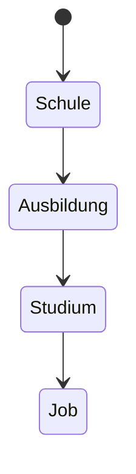
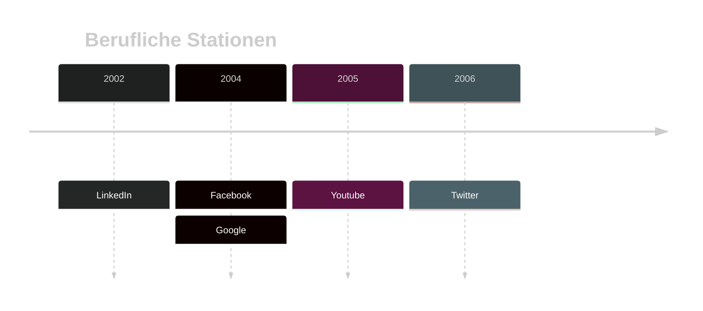

## <mark style="background: #FF5582A6;">Zur Person</mark>
- Position: 
- Alter:
- Wohnort:
## <mark style="background: #FFB86CA6;">Bildungsweg</mark>

## <mark style="background: #BBFABBA6;">Berufserfahrung</mark>

## <mark style="background: #ABF7F7A6;">(Persönliche) Projekte</mark>
- 
## <mark style="background: #ADCCFFA6;">Mögliche Fragen</mark>
### <mark style="background: #CACFD9A6;">Fachlich</mark>
- 
### <mark style="background: #FFB86CA6;">Motivation</mark>
- 

#hiring #template #cv